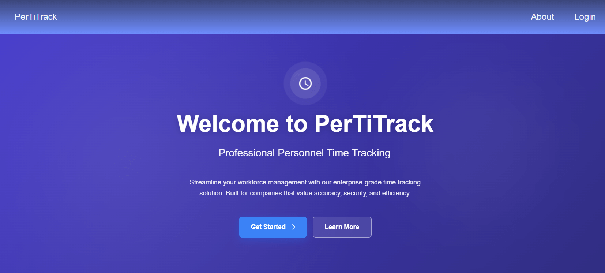
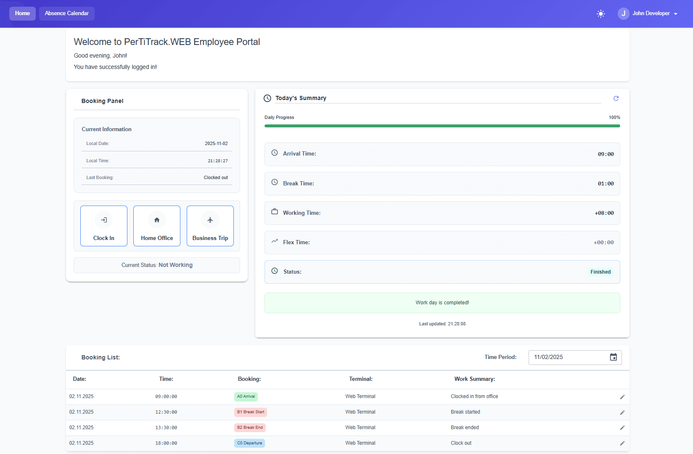
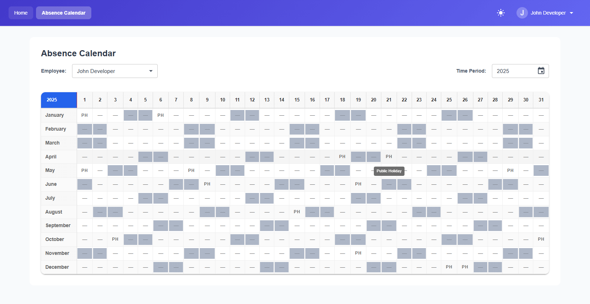

# PerTiTrack - Personnel Time Tracking System

> Capstone Project - [Neue Fische Java Development Bootcamp](https://www.neuefische.de/bootcamp/java-development)

A full-stack web application for employee time tracking, absence management, and workforce analytics. Built with Spring Boot and React.

**[Live Demo](https://www.pertitrack.denizaltun.de/)**

### Demo Credentials
- **Demo credentials and instructions are here:** [ReadMe-Demo](docs/README-DEMO.md)

---

## Tech Stack

<table>
<tr>
<td width="25%">

**Frontend**
- 
- 
- 
- 
- 

</td>
<td width="25%">

**Backend**
- 
- 
- 
- 

</td>
<td width="25%">

**Testing**
- 
- 
- 
- 

</td>
<td width="25%">

**DevOps**
- 
- 
- 
- 

</td>
</tr>
</table>

---

## Features

### Currently Available

| Feature                | Description                                                     | Status |
|------------------------|-----------------------------------------------------------------|--------|
| **Time Tracking**      | Clock in/out with automatic timestamp recording                 | ✅ Complete |
| **Break Management**   | Track break periods (start/end)                                 | ✅ Complete |
| **Location Tracking**  | Office, home office, business trip                              | ✅ Complete |
| **Today's Summary**    | Real-time dashboard with working time, breaks, flex time        | ✅ Complete |
| **JWT Authentication** | Secure token-based authentication                               | ✅ Complete |
| **Employee Role**      | Basic employee access and time tracking                         | ✅ Complete |
| **Absence Tracking**   | Review yearly employee absence records with visual highlights | ✅ Complete |

### In Development

| Feature                 | Description                                             | Status |
|-------------------------|---------------------------------------------------------|--------|
| **Timesheet**           | Review daily work records for the entire month in a single page | 🚧 Planned |
| **Absence Management**  | Vacation/sick leave requests and approvals              | 🚧 Planned |
| **Manager Role**        | Team oversight and approval workflows                   | 🚧 Planned |
| **Admin Role**          | User management and system configuration                | 🚧 Planned |
| **Reports & Analytics** | Timesheet exports and workforce analytics               | 🚧 Planned |
| **Calendar View**       | Visual team availability calendar                       | 🚧 Planned |

---

## Screenshots

### Landing Page


### Dashboard & Time Tracking


### Absence Calendar


---

## Architecture

### System Overview

```
┌─────────────┐
│   Browser   │
│ React + TS  │
└──────┬──────┘
       │ REST API + JWT
┌──────▼──────┐
│   Spring    │
│  Security   │
└──────┬──────┘
       │
┌──────▼──────┐
│  Business   │
│   Layer     │
└──────┬──────┘
       │
┌──────▼──────┐
│ Spring JPA  │
└──────┬──────┘
       │
┌──────▼──────┐
│ PostgreSQL  │
└─────────────┘
```

### Database Structure

<table>
<tr>
<th>Schema</th>
<th>Tables</th>
<th>Purpose</th>
</tr>
<tr>
<td><code>app_users</code></td>
<td>
• <code>users</code><br>
• <code>user_roles</code><br>
• <code>user_sessions</code>
</td>
<td>Authentication & Authorization</td>
</tr>
<tr>
<td><code>app_personnel</code></td>
<td>
• <code>employees</code>
</td>
<td>Employee Profiles</td>
</tr>
<tr>
<td><code>app_timetrack</code></td>
<td>
• <code>time_records</code><br>
• <code>absence_types</code><br>
• <code>absences</code><br>
• <code>work_schedules</code>
</td>
<td>Time Tracking & Absences</td>
</tr>
</table>

**Key Relationships:**
- `users` → `employees` (one-to-one)
- `employees` → `time_records` (one-to-many)
- `employees` → `absences` (one-to-many)
- `absence_types` → `absences` (one-to-many)

---

## Quick Start

### Prerequisites
- Java 21+
- Node.js 18+
- PostgreSQL 17+
- Maven 3.8+

### Setup

```bash
# Clone repository
git clone https://github.com/ad-altun/PerTiTrack.git
cd PerTiTrack

# Database (Docker)
docker-compose up -d

# Backend
cd backend
mvn spring-boot:run

# Frontend (new terminal)
cd frontend
npm install && npm run dev
```

**Environment Variables:**

```env
# Backend (.env or application-dev.properties)
SPRING_DATASOURCE_URL=jdbc:postgresql://localhost:5432/pertitrack
SPRING_DATASOURCE_USERNAME=admin
SPRING_DATASOURCE_PASSWORD=admin
JWT_SECRET=your-256-bit-secret-minimum-32-chars
CORS_ALLOWED_ORIGINS=http://localhost:5173

# Frontend (.env)
VITE_API_BASE_URL=http://localhost:8080/api
```

---

## API Overview

**Base URL:** `http://localhost:8080/api`

### Authentication

| Endpoint | Method | Description |
|----------|--------|-------------|
| `/auth/signup` | POST | Register new user |
| `/auth/signin` | POST | Login and get JWT token |

### Time Records

| Endpoint | Method | Auth | Description |
|----------|--------|------|-------------|
| `/timetrack/time-records/time-bookings/clock-in` | POST | ✓ | Clock in |
| `/timetrack/time-records/time-bookings/clock-out` | POST | ✓ | Clock out |
| `/timetrack/time-records/time-bookings/break-start` | POST | ✓ | Start break |
| `/timetrack/time-records/time-bookings/break-end` | POST | ✓ | End break |
| `/timetrack/time-records/today` | GET | ✓ | Get today's summary |
| `/timetrack/status/current` | GET | ✓ | Get current work status |

**Example Request:**

```bash
curl -X POST http://localhost:8080/api/auth/signin \
  -H "Content-Type: application/json" \
  -d '{"username": "demo@pertitrack.denizaltun.de", "password": "Demo1234!"}'
```

**Example Response:**

```json
{
  "token": "eyJhbGciOiJIUzI1NiJ9...",
  "type": "Bearer",
  "roles": ["ROLE_EMPLOYEE"]
}
```

*For detailed API documentation, see [docs/api.md](docs/api.md)*

---

## Security

### Authentication & Authorization

<table>
<tr>
<td width="40%"><strong>Feature</strong></td>
<td><strong>Implementation</strong></td>
</tr>
<tr>
<td>Password Encryption</td>
<td>BCrypt with strength 12</td>
</tr>
<tr>
<td>Token Type</td>
<td>JWT with HMAC SHA-256</td>
</tr>
<tr>
<td>Token Expiration</td>
<td>15 minutes</td>
</tr>
<tr>
<td>Session Management</td>
<td>Stateless (JWT-based)</td>
</tr>
<tr>
<td>Authorization</td>
<td>Role-based access control (RBAC)</td>
</tr>
</table>

### Role Permissions

| Role | Status | Permissions |
|------|--------|-------------|
| **EMPLOYEE** | ✅ Active | Time tracking, profile view, personal reports |
| **MANAGER** | 🚧 Planned | Employee oversight, approvals, team reports |
| **ADMIN** | 🚧 Planned | User management, system config, all access |

---

## Testing

### Backend Tests

```bash
cd backend
mvn test                    # Run all tests
mvn test -Dtest=AuthServiceTest  # Run specific test
```

**Test Coverage:**
- Unit tests with JUnit 5 and Mockito
- Integration tests with H2 in-memory database
- Test profiles for isolated environments

**Key Test Suites:**
- `AuthServiceTest` - Authentication flows
- `TimeRecordServiceTest` - Business logic validation
- `EmployeeServiceTest` - CRUD operations
- `DatabaseMonitoringTest` - Health check functionality

### Frontend Tests

```bash
cd frontend
npm run test
```

---

## Deployment

### Infrastructure

**Self-hosted on Hetzner Cloud VPS via Coolify**

- Application: Docker container on VPS
- Database: PostgreSQL on same VPS
- Reverse Proxy: Managed by Coolify
- SSL: Automatic via Coolify/Let's Encrypt

### CI/CD Pipeline

**GitHub Actions workflow:**

1. **Build Frontend** (Node 22)
   - Install dependencies
   - Build React app
   - Upload artifacts

2. **Build Backend** (Java 21)
   - Download frontend build
   - Copy to `src/main/resources/static`
   - Maven package (skip tests in CI)
   - Upload `app.jar`

3. **Docker Build & Push**
   - Create multi-stage image
   - Push to Docker Hub with tags:
     - `latest`
     - `{commit-sha}`

4. **Deploy to Coolify**
   - Trigger deployment via webhook
   - Coolify pulls latest image
   - Zero-downtime rolling update

**Manual Deployment:**

```bash
# Build and push
docker build -t your-image:latest .
docker push your-image:latest

# Deploy via Coolify API
curl -X POST -H "Authorization: Bearer $TOKEN" $COOLIFY_WEBHOOK_URL
```

---

## Technical Highlights

### Production-Ready Features
- ✅ Secure JWT authentication with 15-minute token rotation
- ✅ Real-time time tracking with automatic overtime calculation
- ✅ Comprehensive absence review with visual calendar
- ✅ Role-based access control (RBAC) foundation
- ✅ Zero-downtime deployment pipeline

### Architectural Decisions
- **Chose PostgreSQL** over NoSQL for complex relational data integrity
- **Implemented JWT** instead of sessions for stateless scalability
- **Built monolithic first** - appropriate for the domain complexity
- **15-minute token expiry** balances security with user experience

---

## Project Stats


---

## License

MIT License - see [LICENSE](LICENSE) file for details.

## Contact

**Abidin Deniz Altun**

- GitHub: [@ad-altun](https://github.com/ad-altun)
- LinkedIn: [Abidin Deniz Altun](https://www.linkedin.com/in/abidin-deniz-altun-46906a71/)
- Email: contact@denizaltun.de

---

⭐ **Star this repository** if you find it helpful!
